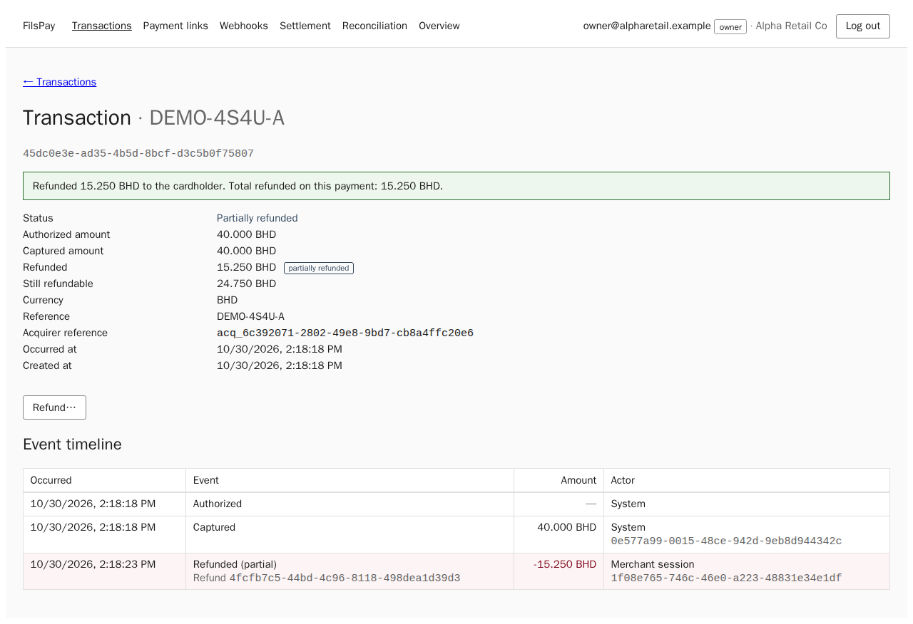
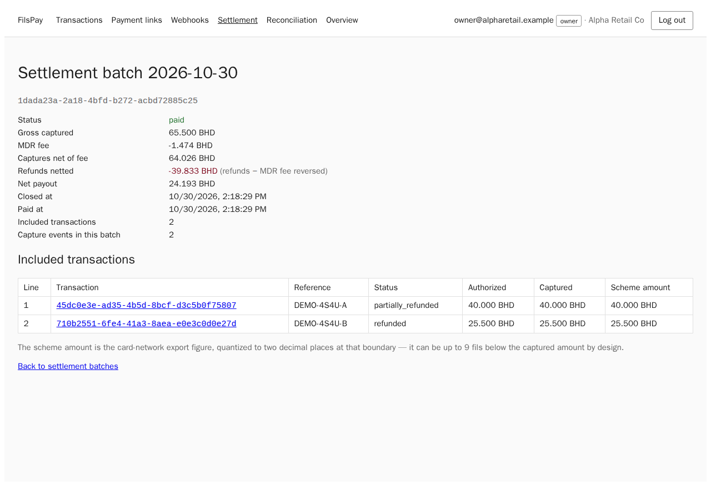

<!-- _class: lead -->
# Hackademics — FilsPay

## 1 · Team

| | Owned |
|---|---|
| **Aya Ismail** | API & payments, FP-300 refunds (API, ledger, webhooks), auth & security, checkout + dashboard UI |
| **Lamees Adel** | Settlement & finance (Go, fees, reconciliation), hosting on Dilmune Cloud, capacity testing, findings report |

https://168-144-92-39.sslip.io · admin.168-144-92-39.sslip.io · api.168-144-92-39.sslip.io

---

## 2 · Root cause

<div class="big">Two sources of truth everywhere — and the code trusted the wrong one.</div>

| Trusted | Instead of | Symptom it explains |
|---|---|---|
| balance cache / exported captures | the ledger | "Recalculate balances" 135K → 7K; adjustments erased |
| a "cents" parser | the fils rule (1 BD = 1000) | CSV 4.75 BD → 0.475 BD |
| a UTC instant | the Bahrain business day | close at 03:15, filters 3 h off |
| the client's clock | the server | links paid after expiry |
| the display schedule / TS formula | the charge schedule / Go | 245 vs 225 bps; 1-fil TS/Go drift |

…and the docs meant to catch it (AI instruction files, 3 ADRs, "intentional" comments, tests asserting bugs) reinforced it.

---

## 3 · Key findings (ranked by impact)

| # | Finding | One line of evidence |
|---|---|---|
| 1 | **Login without the OTP**, and login bound to another merchant's user | pre-OTP cookie → 200 on `/v1/auth/me` before, 401 after (`authSecurity.new.test.ts`) |
| 2 | **Money moved twice**: same link charged twice; concurrent refunds both paid | 3 × 6.000 BD refunds on 10.000 captured → [200, 422, 422]; link lock → 409 |
| 3 | **Ledger vs cache**: balance button, MDR rewriting paid batches, split payouts short | button == CLI after payout (`refresh_ledger_test.go`); paid batch unchanged; 1001 fils splits to 1001 |
| 4 | **FP-300 refunds unfinished** (501 + 7 bugs in "done" helpers) | live e2e: fee back 68 + 157 = **225 = fee charged**, ledger nets 0 |

87 findings total · 10 Critical · 39 High — each with symptom, repro, root cause, fix, proof, effect on existing data.

---

## 4 · Fixes and proof

- **Smallest fix + a test for every finding** · TS **536 / 536**, Go **67 / 67** on a fresh seeded DB
- **Tests that asserted bugs were corrected, never weakened** (e.g. 600 → 6000 fils for 6.000 BD)
- **Money:** `parseBhdToFils`; scheme file from truncated integer + residue journaled (ADR-0002); largest-remainder splits; one ledger source for balances
- **Concurrency:** `SELECT … FOR UPDATE` across the acquirer call; DB `CHECK (refunded ≤ captured)`; unique indexes + `ON CONFLICT` for callbacks and payout notifications
- **Security:** OTP required + rotated, rate limits, timing-safe signatures over the exact bytes, merchant-scoped queries, read-only impersonation
- **Existing data:** 51 read-only detection queries (`docs/sql/existing-data-checks.sql`) + a compensating action per finding — nothing run against data

---

## 5 · Live demo — full + partial refund end to end

<div class="cols">





</div>

Pay 40.000 + 25.500 BD → refund **15.250 (partial)** + **25.500 (full)** → close the day → batch: gross 65.500, fee 1.474, refunds 40.750, fee back 0.917 → **net 24.193 BD**, reconciliation gap **0.000**. Script + fallback screenshots: `docs/ui/DEMO.md`.

---

## 6 · Under load

```
443 ─► Caddy (TLS) ─► web / admin nginx ─/api─► API 0.5 vCPU · 512 MB ─► Postgres (not exposed)
                                                  settlement (Go) · reporting
```

| | Estimated | Measured (live, HTTPS) |
|---|---|---|
| Concurrent checkout users at 0 errors / 0 shed | ≈ 120 on the reference core → **≈ 33–50** scaled to the server's core (27.5 %) | **≈ 50 users · 18.7 checkouts/s · 58 req/s** |
| Past the limit (100–150 users) | fast `503 overloaded` + `Retry-After` | 11–24 % shed in ≈ 0.7 s, **0 server errors**, throughput holds |
| Crash / DB restart | Docker restart, API survives DB restart | API `kill -9` back in 1.3 s · DB restart → 4 s of 503s · integrity check clean |

Bottleneck: the single vCPU (API at its 0.5 cap + Postgres). Load test found 4 bugs: missing pay-path indexes, phantom 500s, DB restart crashed the API, no overload protection.

---

## 7 · How we used AI

**Setup:** one lead Claude Code session + ≤ 4 fresh worker subagents (disjoint files, own DB) + a fresh-context reviewer; `CLAUDE.md`, `.claude/` (permission rules, commands, agents), `ai/`.

**One time the AI was wrong — and how we caught it:**
a worker "fixed" the 3 am close by changing `BusinessDayWindow`; the existing test `TestBusinessDayWindow_IgnoresClockTime` failed. We read the test's intent — the function takes a *calendar date* — reverted, and fixed the caller (`BusinessDate(now)`) with a new test.

Also: the repo's own `CLAUDE.md` said "cents" and "UTC" — checked against the brief before any code; workers' "tests pass" were re-run on a fresh seeded DB.

---

## 8 · Decisions and open risks

| Chose not to | Why | Safeguard / next step |
|---|---|---|
| Run remediation on production data | audit first, append-only ledger | 51 detection queries + compensating entries per finding |
| Change the refund error body / react-router major | keep original contracts; client-side only | documented; upgrade in a normal release |
| Make the reporting consumer skip bad events | skipping silently drops money events | fail-stop now names the outbox id; add alerting |
| Rotate the leaked signing secret | it lives in git history | **rotate before real traffic** |

Open: in-memory rate limits (single instance), SSRF to internal https hosts, 3/61k pays captured-not-finalized after a kill mid-request (healed on retry, no double charge) → single-transaction finalize.

---

<!-- _class: appendix -->
## Appendix A · Live load test, per step (HTTPS, live server)

| Users | req/s | paid/s | shed | server errors | pay p50 | pay p95 |
|---:|---:|---:|---:|---:|---:|---:|
| 10 | 13.8 | 4.4 | 0 % | 0 | 751 ms | 966 ms |
| 25 | 33.5 | 10.9 | 0 % | 0 | 792 ms | 1011 ms |
| **50** | **58.4** | **18.7** | **0 %** | **0** | 1054 ms | 1604 ms |
| 100 | 86.8 | 18.8 | 10.9 % | 0 | 2324 ms | 3171 ms |
| 150 | 117.8 | 11.4 | 23.9 % | 0 | 3756 ms | 5769 ms |

<span class="small">Latencies include ≈ 0.3 s network round trip per request (workstation → DigitalOcean blr1). Non-2xx: 1,916 shed 503, 103 simulated declines (402), 45 simulated acquirer outages (502, JSON from the API). Full method: `docs/CAPACITY.md`.</span>

---

<!-- _class: appendix -->
## Appendix B · Test output and queries

- `npm test` (fresh DB, migrate + seed): API 444 · money 40 · web 21 · reporting 17 · admin 6 · events 4 · scripts 4 = **536 / 536**
- `go test -p 1 ./...` with a DB: **67 / 67**, `go vet` clean
- `scripts/integrity-check.ts` after 61k load-test pays + kill tests: every acknowledged pay committed, no double charge, all ledger groups net 0, refunded ≤ captured, cache = ledger
- `docs/sql/existing-data-checks.sql`: 51 read-only queries, run against the seeded DB with `ON_ERROR_STOP=1` (exit 0)
- Findings: `docs/FINDINGS.md` · Security: `docs/SECURITY_REVIEW.md` · AI: `docs/AI_USAGE.md` · UI: `docs/UI_UX.md`
